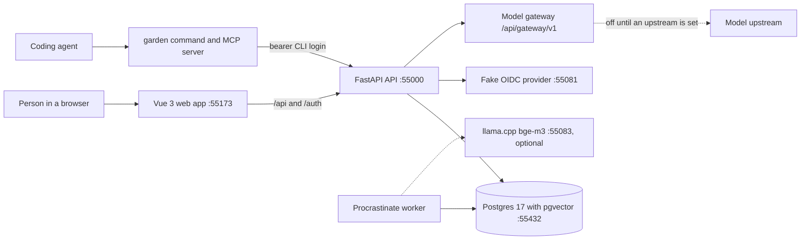

# Garden

[](https://github.com/ycchoo28/garden/actions/workflows/check.yml)

Garden is a small internal portal for team spend at a fictional company, Fernhill Studio.
It is a modular FastAPI and Vue 3 codebase, built to show how the checks around the code let coding agents change it safely.
It also ships a `garden` command and an MCP server, so an agent can act for a signed-in person, within what that person may do.

## The gardening idea

Gardening means designing and maintaining the environment that coding agents work in, so that their changes stay correct.
A model writes code quickly, and nobody reviews every line, so the rules have to be enforced by tools instead of memory.
Garden keeps these rules in the repository:

- Architecture tests walk every installed route and fail when a route has no permission check and is not listed as public ([ADR 0010](docs/adr/0010-deny-by-default.md)).
- Every route declares an operation id and a description with `op(...)`, and a test fails on two routes with the same id ([ADR 0011](docs/adr/0011-operation-declarations.md)).
- Import contracts in `backend/pyproject.toml` stop core modules from importing business modules and enforce the four layers of each module ([ADR 0002](docs/adr/0002-layers-and-dependency-injection.md)).
- The API contract carries each route's permission as `x-permission` and its agent metadata as `x-agent`, and the `garden` command and MCP server build their tools from that contract ([ADR 0023](docs/adr/0023-cli-discovery-and-mcp.md)).
- Every permission states whether an agent may hold it, with no default ([ADR 0022](docs/adr/0022-agent-login-permissions.md)).
- A critical action taken by an agent waits for the person's approval in the browser, and the approval is bound to that one request ([ADR 0012](docs/adr/0012-confirmation-gate.md)).
- `just new-module` creates a module from one template, and CI builds a throwaway module from it and runs the full check on that module ([ADR 0013](docs/adr/0013-scaffold.md)).
- Every business change writes its audit row in the same transaction ([ADR 0008](docs/adr/0008-audit-in-the-same-transaction.md)).
- The rules for working in the repository are in [AGENTS.md](AGENTS.md), and the decisions behind them are in [docs/adr](docs/adr/README.md).

## Architecture at a glance



The API is one FastAPI app with one Postgres database, split into modules.
Core modules are users, audit, files, approvals, confirmations and gateway.
Business modules are claims, budgets, spend and knowledge.
Each module owns one Postgres schema, and no foreign key crosses schemas.
The worker runs the same code as the API and handles the background jobs of the knowledge module.
The web app is a Vue 3 single-page app that calls the API through a client generated from the contract.
The `garden` command and its MCP server use the same contract, and they show only the tools the signed-in person may use.

## Hardware

- Docker with Compose, running on a machine with about 4 to 8 GB of RAM.
  Postgres, the API, the worker and the Vite dev server together are the main load.
  These figures are estimates, not measurements.
- Disk for the container images (Postgres 17 with pgvector, the fake identity provider, and the llama.cpp image when you use embeddings), plus Python and JavaScript dependencies.
  I have not measured the image sizes.
- The optional local embedding model is `bge-m3`, quantised to Q8_0, and its file is about 0.63 GB (634,553,760 bytes at the pinned revision).
  `just models` downloads it and checks its SHA-256, and `just embedding-up` starts the server.
  Preparing a knowledge batch and searching the knowledge both call that server, so the policy search in the demo needs it running.
- No model API key is needed for anything in this README.
  The model gateway stays off until `GARDEN_GATEWAY_UPSTREAM_URL` is set.

## Setup

Install these first:

- Docker, with Compose.
- [just](https://just.systems) 1.58.0, the command runner.
- [uv](https://docs.astral.sh/uv/) 0.13.1, for Python 3.12 and the backend tools.
- [Bun](https://bun.sh) 1.4.3, for the frontend.
- gitleaks 8.30.1, only if you run `just quick` or `just check`, because the secrets check uses it.

The versions are in `.tool-versions`.
Then run these from the repository root:

```sh
git clone https://github.com/ycchoo28/garden.git
cd garden
just setup    # creates .env from .env.example and installs the dependencies
just demo     # starts Postgres and the fake sign-in provider, migrates, seeds Fernhill Studio, then starts the API, the worker and the web app
```

Open http://localhost:55173 and choose a seeded person.
The fake sign-in page takes the person's email as the subject, so `marcus.lee@fernhill.example` signs in as Marcus Lee.

`just demo` needs no model and no API key.
It uses the local embedding server when `just embedding-up` is running, and otherwise starts the small fake embedding server that the tests use, and it prints which one it chose.
The fake gives repeatable vectors, so search works but ranks by shared words rather than meaning.

Use `just reset` to return to a clean seeded state.
It asks you to type `reset`, then drops and recreates the dev database named in `.env`, migrates and loads the demo data again.
It refuses a database whose name ends in `_test`.
It does not remove the files in `var/files`, which are stored by their SHA-256, so they stay on disk.

To run the browser tests as well, install Chromium once with `cd frontend && bunx playwright install chromium`.
`just check` runs the browser tests and needs it.

## Three-minute demo

The seeded people are below.
Each signed-in person also holds `employee`, which the table does not repeat.

| Name | Email | Department | Roles in the seed | Used for |
| --- | --- | --- | --- | --- |
| Marcus Lee | `marcus.lee@fernhill.example` | Design | none | claimant, and the agent's person |
| Priya Nair | `priya.nair@fernhill.example` | Design | manager | approves Design claims at the first step |
| Ana Costa | `ana.costa@fernhill.example` | Engineering | manager | approves Engineering claims |
| Tomas Berg | `tomas.berg@fernhill.example` | Engineering | none | a second claimant |
| Mei Tan | `mei.tan@fernhill.example` | Marketing | manager | approves Marketing claims |
| Sam Okafor | `sam.okafor@fernhill.example` | Marketing | none | a second claimant |
| Lena Fischer | `lena.fischer@fernhill.example` | Operations | finance | second-step approver, budgets, card statements, month close |
| Dev Admin | `dev.admin@fernhill.example` | Operations | admin, knowledge_admin | administration and a second knowledge approver |
| Noor Haddad | `noor.haddad@fernhill.example` | Operations | knowledge_admin | knowledge batches |

Use a private window for each person, because each browser keeps one session.

1. **Claim flow (about one minute).**
   Sign in as Marcus Lee, open Claims, create a draft, add a line with its receipt and submit it.
   Sign in as Priya Nair, open Approvals, and approve the claim at the manager step.
   A claim above 500 USD then waits for a finance decision from Lena Fischer, and the same person cannot decide both steps.
2. **Budget variance (about 40 seconds).**
   Sign in as Lena Fischer and open Budgets, then Variance, to see every department.
   Sign in as Priya Nair and open the same page, and she sees only Design.
3. **An agent drafts a claim and is refused when it submits (about one minute).**
   On a terminal as Marcus Lee, after `uv tool install ./agent` and `garden login`:

   ```sh
   garden tools
   garden claims claim create --title "Client lunch, October" --json
   garden claims claim submit --claim-id <id from the output> --expected-version 1
   ```

   The `create` command makes a draft.
   `submit` is not a command for the agent, because the route is marked `tool: false` and certifying and submitting are person-only, so the command stops with an argument error.
   Through MCP, the same call returns `Tool not available`.
   The agent cannot add a claim line either, because the receipt must be uploaded first and the command cannot upload files yet (see the gaps below).
   The person adds the line in the browser.
4. **A gated month close (about 40 seconds).**
   On a terminal as Lena Fischer, close last month, which the demo seed leaves open (here 2026-10):

   ```sh
   garden spend month close --year-month 2026-10 --reason "October books final"
   ```

   The command prints a link and waits.
   Open the link in the browser, signed in as Lena Fischer, and approve the request on the confirmation page.
   The command then closes the month once, and `garden spend month list` shows it.
   If nobody approves within ten minutes, the close does not run.
5. **Access-filtered policy search (about 40 seconds).**
   As Marcus Lee, search the expense policy:

   ```sh
   garden knowledge search run --query "receipts for claim lines"
   ```

   Then search for something that appears only in the finance procedures, such as `"month close procedure"`.
   Marcus Lee gets the expense policy and no finance procedure, because each collection's rules name the roles and departments that may read it.
   Lena Fischer, who holds `finance`, gets the finance procedure.

The demo seed adds twelve months of budget lines and card statements ending in the current month, with all but the last two months closed.
It also adds claims in every status, including "Build farm hardware" waiting for the finance step, and ten policy documents in two collections.

## Plug the MCP server into Claude Code

The MCP server runs as the person who signed in on this device, and it offers only the tools that person may use.
Install the command and sign in once:

```sh
uv tool install ./agent
garden login
```

Then add the server to Claude Code:

```sh
claude mcp add garden -e GARDEN_API_URL=http://127.0.0.1:55000 -- garden mcp
```

`garden` must be on the PATH of the process that starts it, which `uv tool install` arranges.
The `GARDEN_API_URL` variable is required, because the command has no default portal address.
The tools are named after the operation ids with underscores, such as `claims_claim_create`.
To install the skill file that tells an agent how to use the command, run `garden skills install`, which copies it to `~/.garden/skills`.

## Commands

Run `just` with no arguments to list them.

| Command | What it does |
| --- | --- |
| `just setup` | Creates `.env` from `.env.example` and installs the dependencies for the backend, the agent and the frontend. |
| `just demo` | Starts Postgres and the fake sign-in provider, migrates, seeds the demo data, then starts the API, the worker and the web app. |
| `just up` | Starts Postgres and the fake sign-in provider in Docker Compose, and waits until they are healthy. |
| `just migrate` | Applies the Alembic migrations and creates the job queue tables when they are missing. |
| `just seed` | Loads Fernhill Studio and the seeded people. It is safe to run again. |
| `just dev` | Seeds, then runs the API with reload, the worker and the web app until Ctrl+C. |
| `just reset` | Drops and recreates the dev database after you type `reset`, then migrates and loads the demo data again. |
| `just models` | Downloads the pinned bge-m3 model into `var/models` and checks its SHA-256. |
| `just embedding-up` | Starts the local embedding server in Compose. It is not part of `just up`. |
| `just quick` | Runs the fast checks: backend format, lint and types, import contracts, the agent package, frontend types, lint, unit tests and colour rules, the API contract, secrets, doc links and the deny-list. |
| `just check` | Runs `just quick`, the backend and agent tests against Postgres, the browser tests, and the dependency audits. |
| `just test` | Runs the backend and agent tests against a `*_test` database in Postgres. |
| `just e2e` | Runs the browser tests against a fresh `garden_e2e` database. It needs Chromium and the fake sign-in provider. |
| `just api` | Regenerates the OpenAPI contract and the frontend client. Never edit those files by hand. |
| `just api-check` | Regenerates them and fails if that changes any file. |
| `just new-module <name>` | Scaffolds a business module, registers it, and regenerates the contract and client. |
| `just hooks` | Installs the pinned lefthook and its commit hooks. Run it once after cloning. |
| `just backend-check`, `just agent-check`, `just frontend-check` | Run the format, lint and type checks of one part. |
| `just secrets-check` | Scans the git history and the working tree with gitleaks. |
| `just docs-check` | Checks that the relative links in the Markdown files point at real files and headings. |
| `just deny-check` | Fails when a file names a term on the deny-list. |
| `just backend-audit`, `just frontend-audit` | Audit the locked dependencies, with accepted advisories from `security/allowlist.txt`. |

The `garden` command has these local commands: `login`, `logout`, `whoami`, `tools`, `mcp` and `skills install`.
Every other command comes from the contract, named after its operation id, such as `garden files file upload`.

## Ports

All of these bind to 127.0.0.1.

| Port | Service |
| --- | --- |
| 55000 | The API (uvicorn). |
| 55173 | The web app (Vite dev server). It proxies `/api` and `/auth` to the API. |
| 55432 | Postgres 17 with pgvector. |
| 55081 | The fake OpenID Connect provider. |
| 55083 | The llama.cpp embedding server, when you run `just embedding-up`. |

The fake sign-in provider accepts any subject, and the backend refuses it outside the `dev` environment.

## Known gaps

- The `garden` command cannot send a file, so an agent cannot upload a receipt or import a card statement.
  The upload routes take multipart bodies, and the command only sends JSON.
- The model gateway forwards nothing until an upstream is configured, so the live agent chat is not part of the demo.

## Where to read next

- [AGENTS.md](AGENTS.md) is the working guide for coding agents and people who change the code.
- [GLOSSARY.md](GLOSSARY.md) defines the domain words, and the terms to avoid.
- [docs/code-patterns.md](docs/code-patterns.md) shows how backend and frontend code is laid out.
- [docs/ui.md](docs/ui.md) covers the frontend shell, theme tokens and colour rules.
- [docs/adr/README.md](docs/adr/README.md) lists the architecture decisions.

## Licence

MIT. See [LICENSE](LICENSE).
