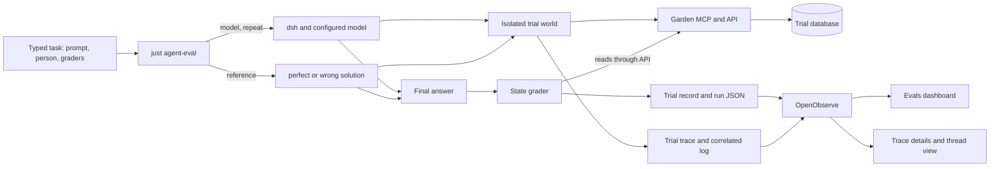
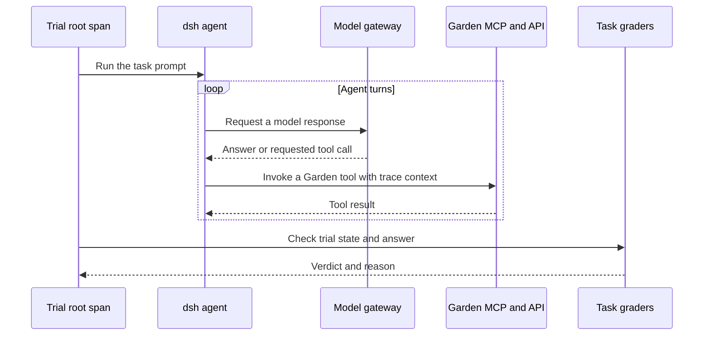

# Agent eval design and views

Garden's evals test whether an agent completes a user task through the real Garden API, with the right state and boundaries.
The eval runner lives under [`agent/tests/evals/`](../agent/tests/evals/README.md), and its decisions are recorded in [ADR 0029](adr/0029-own-agent-eval-system.md), [ADR 0030](adr/0030-agent-trace-contract.md) and [ADR 0031](adr/0031-openobserve-for-evals-and-agent-telemetry.md).

## Design

Each attempt runs in its own trial world, based on a seeded database clone, an API process, an Agent login and an isolated dsh home and workspace.
Model trials use dsh and the configured model gateway; reference trials use scripted solutions against the same tools and trial API.
Graders check the API state, answer constraints or knowledge answer, then the runner writes a JSON record and sends logs and traces to OpenObserve when it is available.

The trial database is disposable and separate from the developer database.
Reference runs provide repeatable checks for the task and graders, while real-model runs compare configured models across repeated attempts.
The terminal output and JSON summary remain available if OpenObserve cannot accept telemetry.

## OpenObserve comparison grid

The checked-in [Evals dashboard](../observability/openobserve/dashboards/evals.json) reads trial records from the `garden_eval_trials` log stream.
Choose one or more tasks or models in the `Task` and `Model` multi-select dropdowns (or `All` for all values), and set `Run ID` to a specific run or `_o2_all_` for all runs.
Clicking a row in the table panels (`Task by model grid`, `Grader verdicts`, `Trials and traces` or `Generated artifacts`) offers `Open task in catalog`, which switches to the `Task catalog` tab filtered to that task only.
The comparison panels exclude the `reference` model so scripted checks do not affect model scores.

| Dashboard panel | View | What it shows |
| --- | --- | --- |
| Pass rate by task and model | Heatmap | Fraction of completed trials that passed for each task and model. |
| Pass^k by task and model | Heatmap | Whether every requested repeat passed without an aborted repeat. |
| Task by model grid | Table | Trial counts, passes, pass rate and the all-repeats `PASS` or `FAIL` value. |
| Tool calls, tokens, and duration | Bar chart | Average tool calls, tokens and elapsed seconds by task and model. |
| Pass rate trend by run | Line chart | Pass rate across runs for each model. |
| Selected run summary, Passing trials, Tool calls, Tokens, Duration seconds | Metrics | Aggregate results for the selected filters. |
| Grader verdicts | Table | Per-trial grader outcomes and failure reasons. |
| Trials and traces | Table | Per-trial metrics and a link to its trace. |

The Task by model grid exposes these columns:

| Task | Model | Trials | Passes | Pass rate | Pass^k |
| --- | --- | --- | --- | --- | --- |
| Task id | Model id | Completed and requested counts | Passed trial count | Passed divided by completed | `PASS` only when all requested repeats passed and none were aborted |

Both `just agent-eval` and `just eval-ui` start the local viewer and apply the checked-in stream schemas, dashboards and generated task catalog automatically; run `just eval-dashboards` to refresh them at any time without running trials.
OpenObserve listens on `127.0.0.1:55086` by default, and `GARDEN_EVAL_OPENOBSERVE_PORT` selects another loopback port.
The local root password is stored in the ignored `var/openobserve.env` file.

## Trial trace and thread view

The trial root span is named `task / model / repeat` and carries the run, trial, task, suite, area, model and repeat identifiers.
The gateway and API spans follow the shared trace contract and use the propagated trace context to keep one trial together.
By default, model spans contain metadata such as status, token counts and tool names, while prompt and answer capture stays off unless an explicit development or eval setting enables it.

In the dashboard's Trials and traces table, open a row's trace link to view the matching trace in OpenObserve.
The thread view groups the trial root with its correlated gateway and API spans, so a reader can move from a failed verdict to the operations that preceded it.
Trial log rows include the same trace id, task id, model, repeat and grader reasons for filtering and drill-down.

The dashboard definition is versioned in [`observability/openobserve/dashboards/evals.json`](../observability/openobserve/dashboards/evals.json) and applied by [`scripts/apply_openobserve.py`](../scripts/apply_openobserve.py).
OpenObserve owns the exact layout of its trace and thread views, while the spans, attributes, dashboard panels and queries are defined in this repository.

## Task catalog and title calls

The `Garden agent evals` dashboard has a `Task catalog` tab with every registered question, its suite, confirmation policy, budgets and automated checks.
`just eval-dashboards` reads the same registry as the eval runner and refreshes the catalog without running any trials.
It declares missing stream fields without creating fake observations, so empty or reference-only streams show no data instead of schema errors.
The catalog is independent of the dashboard time range.
The Evals tab uses the selected time range; its default is seven days so setup runs remain visible the next day.

DSH can send a separate request to create a short session title.
That request wraps the human message in a JSON array and asks the model to generate a title.
The task execution uses its own model request with the original task prompt and agent context.
Recognized title calls have the span name `chat conversation_title` and `garden.model.side_call.type=conversation_title`.
They retain the Garden conversation ID and trial trace, and use a separate `gen_ai.conversation.id` ending in `:title` for consumers that group conversations.
OpenObserve's whole-trace Thread view can still combine auxiliary messages.
Headless model evals disable the automatic LLM title provider and use DSH's deterministic title fallback, avoiding the extra request and its token cost.
Interactive sessions retain automatic title generation.
Their usage remains included in gateway model usage.
Previously stored traces keep their original attributes.

Local app and eval exporters use the `garden_eval_traces` stream.
If you configure an exporter yourself, include `stream-name=garden_eval_traces` in its OTLP trace headers for the monitoring dashboard.

### Tool payloads, runtime context and generated artifacts

Eval tracing captures bounded tool arguments and JSON results in development mode.
Production content capture remains disabled.
The model gateway and harness housekeeping requests are not displayed as business tool calls.
DSH runtime-context snapshots are stored in `garden.model.runtime_context`, while the captured human conversation retains the actual task question.
This changes trace presentation only; the model still receives its runtime context.

The `Generated artifacts` panel shows the claim state and generated workspace file previews saved before trial cleanup.
The same snapshot is on the trial root and its `eval.artifacts` child span.
Text previews are bounded; binary files have metadata and a digest rather than a full download.
Workspace symlinks are excluded.
A captured draft is a historical snapshot, not a live claim page backed by the deleted trial database.

The frontend dependency graph contains no `picomatch` and its high-severity audit remains strict.
The unchanged DSH installer lockfile retains `picomatch` through the required `@deepseek-ai/dsh-hmr` package.
The user-approved exception for GHSA-fc5q-39xc-vjpf is recorded only in `security/dsh-audit-exceptions.json`; it is not a global scanner ignore.
Revisit it when that parent drops `picomatch` or a patched release becomes available.
